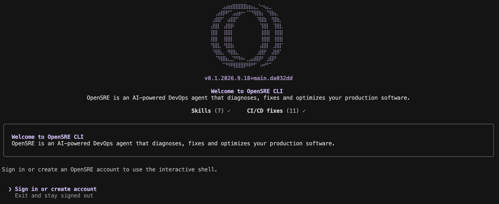

> **[中文化] opensre**
>
> 此项目是 [Tracer-Cloud/opensre](https://github.com/Tracer-Cloud/opensre) 的中文翻译版本。
> - 原项目 Stars: 13153
> - 主语言: Python
> - 许可证: Apache-2.0
> - 翻译日期: 2026-11-20
> - 原始 README: [README_en.md](README_en.md)
>
> 说明：下方 README 正文为**原项目文档的中文翻译**，力求忠于原文；本页顶部的「中文快速上手」为**面向中文用户的补充导读**（非原文内容），目的是让你不用读完整篇 README 就能先把项目跑起来。
>
> 如有翻译不准确之处，欢迎提 Issue 或 PR。

---


## 🚀 中文快速上手（补充导读，非原文）

### 这是什么 / 解决什么问题

OpenSRE 是一个开源的 CI/CD 可靠性 CLI 代理（agent），用 Python 编写，采用 Apache-2.0 许可证。它针对的痛点是：CI 失败时只告诉你「坏了」，却不说明原因和修法。OpenSRE 会读取失败的运行记录、追踪根因，并推送一个修复供你审阅；它自托管，使用你自己的模型。项目当前处于 public alpha 阶段，核心工作流可用于早期探索，但尚未完全稳定。

### 快速上手（最短路径）

1. 准备一个已打开终端的代码项目，建议是一个 Git 仓库（完整工作流演示需要）。
2. 安装（macOS 或 Linux）：
   ```bash
   curl -fsSL https://install.opensre.com | bash -s -- -gh
   ```
   Windows（PowerShell）：
   ```powershell
   & ([scriptblock]::Create((irm https://install.opensre.com/install.ps1))) -gh
   ```
3. 启动 OpenSRE：
   ```bash
   opensre
   ```
   首次启动会激活托管模型，并提示登录。
4. 若 `opensre` 命令找不到，按安装器打印的 PATH 提示操作，或新开一个终端。
5. 可选：以非交互方式跑一轮代理（headless CLI）：
   ```bash
   opensre ask "why is checkout-api slow?"
   ```

### 环境要求

- **操作系统**：macOS、Linux、Windows（Windows 有单独的安装说明文档）。原文未说明其他平台支持情况。
- **硬件**：原文未说明。
- **Python 版本**：`pyproject.toml` 要求 `requires-python = ">=3.12"`；Dockerfile 基于 `python:3.12-slim`。
- **依赖**：安装脚本会从 `main` 拉取最新构建，无需 sudo。Docker 镜像内置 git、GitHub CLI、Node、Codex 及常用 shell 工具；网关模式需要 Slack/Telegram 相关 token 与 LLM provider 及 API key（原文未逐一列出全部变量名）。
- **网络提示**：安装脚本从 `install.opensre.com` 与 GitHub 拉取构建，国内网络环境可能需要更换镜像源或加速下载（原文未提供具体镜像方案）。

### 常见坑与注意事项

- **项目处于 public alpha**：核心工作流可用但未完全稳定，API 与集成可能变化，不建议直接用于生产关键路径。
- **需要账号与模型**：交互式 shell 只对活跃账号开放，首次启动会激活托管模型；headless 与网关模式涉及 LLM provider 和 API key（具体变量原文未完整列出）。
- **交互式 shell 需要 TTY**：无子命令运行 `opensre` 会启动 REPL，要求 TTY 环境；脚本或 CI 中应改用 `opensre ask` 这类 headless 方式。
- **Docker 镜像不预置代码**：镜像只是工具链加 supervisor，启动时才安装当前 main 通道的二进制；工具链变更需重建镜像。

---


---

<div align="center">

<p align="center">
  
</p>

<h1>OpenSRE：面向 CI/CD 可靠性的开源智能体</h1>

<p>CI 只告诉你它挂了，却不告诉你原因和修复方法。OpenSRE 是一个 CLI 智能体，它会读取失败的运行记录、追踪根因，并推送修复供你审查。自托管，使用你自己的模型。</p>

<p align="center">
  <a href="https://github.com/Tracer-Cloud/opensre/actions/workflows/ci.yml?branch=main"></a>
<a href="https://github.com/Tracer-Cloud/opensre/releases"></a>
  <a href="https://github.com/Tracer-Cloud/opensre/blob/main/LICENSE"></a>
  <a href="https://discord.gg/7NTpevXf7w"></a>
    <a href="https://greptile.com"></a>
</p>

<p align="center">
  <a href="https://trendshift.io/repositories/25889" target="_blank">
    
  </a>
</p>

<p align="center">
  <strong>
    <a href="https://www.opensre.com/docs/getting-started/quickstart">快速开始</a> ·
    <a href="https://www.opensre.com/docs">文档</a> ·
    <a href="https://opensre.com/docs/guides/faq">常见问题</a> ·
    <a href="https://trust.tracer.cloud/">安全</a>
  </strong>
</p>

</div>

---

> 🚧 公开 Alpha：核心工作流可用于早期探索，但尚未完全稳定。项目正在积极开发中，API 和集成可能会变化。

---

## 开始之前

请确保你已具备：

- 在代码项目中打开的终端
- 一个 Git 仓库（推荐，用于完整演示工作流）

## 第 1 步：安装并启动 opensre

macOS 或 Linux：

```bash
curl -fsSL https://install.opensre.com | bash -s -- -gh
```

Windows（PowerShell）：

```powershell
& ([scriptblock]::Create((irm https://install.opensre.com/install.ps1))) -gh
```

然后启动 OpenSRE：

```bash
opensre
```



Windows 详情：[Windows](docs/install/windows-local.mdx)。

安装程序从 `main` 获取最新构建，无需 sudo。如果找不到 `opensre`，请按安装程序打印的 PATH 说明操作，或打开新终端。

支持的平台和故障排查，请参阅[本地安装](https://www.opensre.com/docs/install/install-local)。

---

## 目录

- [开始之前](#before-you-begin)
- [安装并启动 opensre](#step-1-install-and-start-opensre)
- [为什么选择 OpenSRE？](#why-opensre)
- [快速开始](#quick-start)
- [部署](#deployment)
- [OpenSRE 如何工作](#how-opensre-works)
- [集成](#integrations)
- [安全](#security)
- [遥测](#telemetry)
- [许可证](#license)
- [引用](#citations)

---

## 为什么选择 OpenSRE？

AI 每月编写越来越多的代码，但总得有人来修复构建。

当 CI 变红时，它只告诉你*有东西*失败了，却不告诉你*为什么*或如何修复。在交付压力下，团队反复重跑然后继续，不稳定的检查越积越多，`main` 持续变红，真正的调查要等某位有空的高级工程师来做。OpenSRE 是一个开源 CI/CD 可靠性智能体，替你完成这项调查，设计为在你自己的基础设施上使用你自己的模型运行：

- **更快从红色构建中恢复：** 运行一失败就立即调查，读取日志、验证假设，并推送修复供你审查
- **修复根因，而非只是重跑：** 区分 CI 导致的失败和代码导致的失败，让你修复正确的东西
- **了解 CI 的成本：** 失败率、因 CI 不可靠而损失的开发者工时，以及 `main` 保持红色的时长
- **人人享有高级工程师级上下文：** 每位工程师都获得同等深度的分析

SWE-bench<sup>1</sup> 表明，智能体在真实任务和清晰反馈下进步最快。流水线失败比本地代码任务更慢、更嘈杂、更难复现，因此我们以同样标准要求 OpenSRE：

- 在云支持的场景中运行真实端到端测试 [(tests/e2e)](tests/e2e)
- 保持语义化测试目录命名，使 e2e 与单元测试、本地与云的边界清晰可见 [(tests/README.md)](tests/README.md)

从 **[CI/CD 概览](docs/cicd/overview.mdx)** 开始：分析仓库的 CI 可靠性、修复 PR 上失败的检查，或设置一个保持 CI 绿色的智能体。

<sup>1</sup> https://arxiv.org/abs/2310.06770

---

## 快速开始

贡献者：从 [`main.py`](main.py) 开始了解进程入口点映射。

运行 `opensre` 登录并开始。首次启动会激活托管模型。

```bash
opensre
```

Web 应用贡献者可运行 `opensre setup --dev` 通过 `http://localhost:3000` 进行认证。

**交互式 Shell** — 不带子命令时，`opensre` 会验证你的账户并启动 REPL（需要 TTY）。你可以退出并保持登出状态，但 Shell 只为活跃账户打开。用自然语言描述事件，观察智能体工作，使用斜杠命令控制会话（`/help`、`/status`、`/cost`、`/sessions`、`/resume`、`/compact`、`/new`、`/exit`）和集成（`/integrations list`、`/integrations verify`）。Ctrl+C 取消进行中的回合而不丢失会话状态。完整参考见 **[交互式 Shell 命令](https://www.opensre.com/docs/getting-started/interactive-shell-commands)**。

**无头 CLI** — 从终端、脚本或 CI 作业中以非交互方式运行一次智能体回合：

```bash
opensre ask "why is checkout-api slow?"
```

stdin 提示、JSON 输出和工具审批见 **[无头 CLI](https://www.opensre.com/docs/guides/headless-cli)**。

**从 Python 调用** — 在你自己的代码中进程内驱动智能体（需要源码检出）：

```python
from surfaces.embedded import start_embedded_session

session = start_embedded_session()
result = session.chat("why is checkout-api slow?")
# ``answered`` is true for any reply text, including a failed model call.
# That failure sets accounting_status to "not_run" and stop_reason to "error".
if result.action_result.accounting_status == "completed" and not result.cancelled:
    print(result.primary_response_text)
```

会话、对话和自定义输出接收器见 **[Python API](https://www.opensre.com/docs/guides/python-api)**。

**用于团队的日常工作流：** 将 OpenSRE 嵌入队友已在使用的 Python 服务和自动化中。
从仓库内的 [Python API 指南](docs/guides/python-api.mdx)开始，然后每天使用它，让事件响应可重复。

其他有用命令：

```bash
opensre integrations setup
opensre update
opensre uninstall   # 移除 opensre 及所有本地数据
```

---

## 部署

OpenSRE Cloud 托管网关、AWS EC2 路径和通用自托管选项：

- **OpenSRE Cloud 托管网关：** 组织管理员在 Web 应用中配置；已登录的 Shell 用户可检查、启动或停止它，无需在本地处理基础设施凭据。
- **网关（AMI + systemd）：** `make build-gateway-image` 然后 `make deploy-gateway` — 仅 Telegram 网关，无 Docker；网关安装到新服务器启动所用的服务器镜像中。
- **自托管容器（Railway / ECS / Vercel）：** 部署仓库的 `Dockerfile`，选择 `MODE`，设置 `LLM_PROVIDER` 及其 API 密钥。仅当网关需要共享的 Postgres 后端状态（如 Slack Events API 副本）时才使用 `DATABASE_URL`。

**[完整部署步骤和前提条件 → DEPLOYMENT.md](DEPLOYMENT.md)**

---

## OpenSRE 如何工作


当 CI 运行失败、收到告警或你提出问题，OpenSRE 会自动：

1. **获取**相关上下文：失败的检查和 CI 日志、最近的提交和部署，以及关联的日志、指标和追踪
2. 在调用外部 LLM 前**遮蔽**敏感标识符（可选）
3. 在你连接的系统间**推理**，在工具调用循环中验证假设，区分 CI 导致的失败和代码导致的失败
4. 在对话中**回答**，附带证据链接
5. **修复**根因并推送到 PR 分支供你审查，或建议后续步骤并可选执行修复操作
6. 直接将摘要**发布**到 Slack、PagerDuty 或 Telegram — 无需切换上下文

移除旧图与链框架层后的当前代码级智能体架构，见 [AGENTS.md](AGENTS.md)。

---

## 集成

OpenSRE 连接现代云技术栈中的 60+ 工具和服务，从 LLM 提供商和可观测性平台到基础设施、数据库和事件管理。

| 类别                | 集成                                                                                                                                                                                                                                                                                                                                                                                                                                                                 | 路线图                                                                                                                                                                                                                                                            |
| ----------------------- | ---------------------------------------------------------------------------------------------------------------------------------------------------------------------------------------------------------------------------------------------------------------------------------------------------------------------------------------------------------------------------------------------------------------------------------------------------------------------------- | ------------------------------------------------------------------------------------------------------------------------------------------------------------------------------------------------------------------------------------------------------------------ |
| **AI / LLM 提供商**  | Anthropic · OpenAI · OpenAI Codex · Ollama · Google Gemini · OpenRouter · TrustedRouter · NVIDIA NIM · Bedrock                                                                                                                                                                                                                                                                                                                                                                               |                                                                                                                                                                                                                                                                    |
| **可观测性**       |  Grafana (Loki · Mimir · Tempo · annotations) ·  Datadog · Honeycomb · Coralogix ·  groundcover ·  CloudWatch ·  Sentry · Elasticsearch · Better Stack · Splunk · Victoria Logs · SignOz · OpenObserve · OpenSearch · Azure Monitor · New Relic |                                                                                                                                                                                                             |
| **基础设施**      |  Kubernetes ·  AWS (S3 · Lambda · EKS · EC2 · CloudTrail · Bedrock) ·  Azure · ArgoCD · Helm                                                                                                                                                  |                                                                                                                                                                                                                                                                    |
| **数据库**            | MongoDB · ClickHouse · PostgreSQL · MySQL · MariaDB · MongoDB Atlas · Azure SQL · Snowflake · Redis · RDS · Supabase · Neon                                                                                                                                                                                                                                                                                                                                                  |                                                                                                                                                                                                                                                                    |
| **数据平台**       | Apache Airflow · Apache Kafka · Prefect · RabbitMQ · Dagster · Temporal                                                                                                                                                                                                                                                                                                                                                                                                |                                                                                                                                                                                                                                                                    |
| **开发工具**           |  GitHub · GitHub MCP · Bitbucket · GitLab · Jenkins                                                                                                                                                                                                                                                                                                                                                                                |                                                                                                                                                                                                                                                                    |
| **事件管理** |  PagerDuty · Jira · Alertmanager · incident.io · ServiceNow · Trello (仅客户端辅助)                                                                                                                                                                                                                                                                                                                                                | [Linear](https://github.com/Tracer-Cloud/opensre/issues/124)                                                                 |
| **通信**       |  Slack · Google Docs · Discord · Telegram ·  Rocket.Chat · WhatsApp · Buzz                                                                                                                                                                                                                                                                                                                                                                     | [Notion](https://github.com/Tracer-Cloud/opensre/issues/286) · [Teams](https://github.com/Tracer-Cloud/opensre/issues/138) · [Confluence](https://github.com/Tracer-Cloud/opensre/issues/313)                                                                   |
| **智能体部署**    |  Vercel ·  EC2 ·  ECS · Railway                                                                                                                                                                                                                                                                                         |                                                                                                                                                                                                                                                                    |
| **协议**           |  MCP                                                                                                                                                                                                                                                                                                                                                     |                                                                                                                                                                                                                                                                    |

OpenSRE 由社区构建。想找一个安全的首次贡献？浏览 [`good first issue`](https://github.com/Tracer-Cloud/opensre/issues?q=is%3Aissue+is%3Aopen+label%3A%22good+first+issue%22) 工单或查看[新手 Issue 指南](docs/good-first-issues/README.md)。完整工作流见 **[CONTRIBUTING.md](CONTRIBUTING.md)**。

**本地环境：** **[SETUP.md](SETUP.md)**（所有平台、Windows、MCP）。

**在本仓库中开发：** **[docs/DEVELOPMENT.md](docs/DEVELOPMENT.md)**（从源码安装、CI 一致性检查、开发容器、部署详情、遥测参考）。

<p>
  <a href="https://discord.gg/7NTpevXf7w">
    
  </a>
</p>

<p align="center">
  <a href="https://www.star-history.com/?type=date&repos=Tracer-Cloud%2Fopensre">
    <picture>
      <source media="(prefers-color-scheme: dark)" srcset="https://api.star-history.com/chart?repos=Tracer-Cloud/opensre&type=date&theme=dark&legend=top-left&sealed_token=LHlhQArnQVcZZDuHHjU19dJHIIzQx9WzB2xacqhOnA8RE