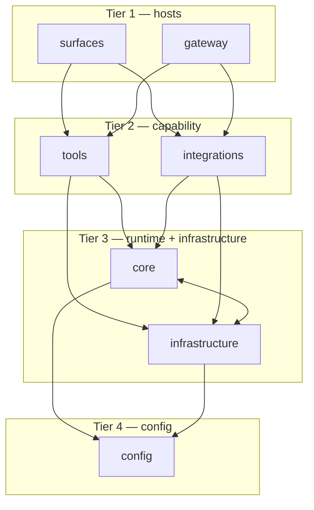
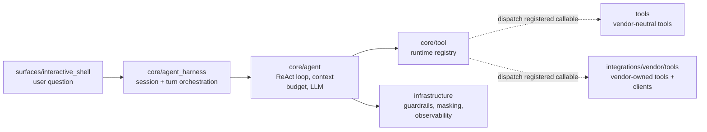
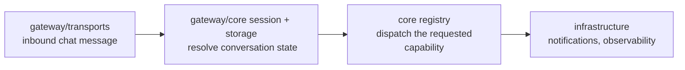

# OpenSRE 架构

OpenSRE 代码库的结构：七个一方包、各自职责，以及谁可以依赖谁。这些依赖规则由 CI 强制执行（`make check-imports`），是真实的不变量，而非愿景。

## 分层栈

这些包分为四层。**高层可以导入低层；低层永远不能导入高层。** 同层包互为对等体——最后一列说明对等体之间能否互相导入。

| 层级 | 包 | 可以导入 | 绝不能导入 | 对等规则 |
| --- | --- | --- | --- | --- |
| 1（顶层） | `surfaces`、`gateway` | `tools`、`integrations`、`core`、`infrastructure`、`config` | — | 相互独立的对等体；不得互相导入，`.importlinter` 中列出的三条已跟踪的 CLI/REPL 网关命令边除外。这是唯一可以同时导入 `tools` **和** `integrations` 的包，因此每个宿主在启动时都会装配两者。 |
| 2 | `tools` | `core`、`infrastructure`、`config` | `surfaces`、`gateway` | `integrations` 的对等体：不得导入它。现有边在 `.importlinter` 中列为债务。 |
| 2 | `integrations` | `core`、`infrastructure`、`config` | `tools`、`surfaces`、`gateway` | `tools` 的对等体：不得导入它。 |
| 3 | `core`、`infrastructure` | `config` | `surfaces`、`gateway`、`tools`、`integrations` | 兄弟包：**可以**互相导入。 |
| 4（底层） | `config` | —（无一方包） | 以上所有 | 独立——不导入任何其他一方包。 |

简记：**依赖只向下指。** 表面层可以一路向下；`config` 什么都够不到。唯一的刻意例外是 `core ⟷ infrastructure`，这是一对设计上互相依赖的包（见下文）。

箭头只显示**相邻**层之间的边，以保持图可读。实际规则更宽：一层可以导入其下方的**任意**层，而不只是紧邻的下一层——因此表面层可以直接导入 `config`，工具可以导入 `infrastructure`。完整允许边集见上表"可以导入"列。

## 各层详解

### 第 1 层——`surfaces` 和 `gateway`

人类或外部系统对话的入口点。任何一方包都不得从这里导入，因此增删表面层无需改动其下层。

- **`surfaces/`**——每个 UI/客户端一个文件夹：`surfaces/cli`（无状态的 `opensre <command>` 运行器）、`surfaces/interactive_shell`（有状态的 REPL），以及 `surfaces/shared` 存放两个或更多表面层共用的代码。表面层拥有自己的 I/O、提示和呈现，并组合下层来完成实际工作。两个终端表面层互为对等体，不互相导入（`tests/shared/test_surface_border.py` 将两个方向都钉为零）；两者共同需要的内容放在 `surfaces/shared`——`terminal/`（输出跟踪、表格、提示、横幅、健康与反馈渲染）、`llm_setup/`、`error_handling/`——或更低层。`surfaces/entrypoint.py` 是 `opensre` 控制台脚本：它向 CLI 传入一个 `CliHost`（如何打开 shell、如何运行附加的网关），因此组合发生在两者之上的一个地方。Slack 不是表面层：其入站传输位于 `gateway/transports/slack`，出站投递位于 `integrations/slack`。
- **`gateway/`**——面向入站聊天平台的独立消息网关（`gateway/transports/{telegram,slack,discord,buzz}`），加上 FastAPI 的 `gateway/web/` 表面层（健康检查、告警接入）以及 `gateway/core/{session,storage,middleware}` 中共享的每轮机制（`middleware/` 存放每个传输都会组合的入站决策、身份和审批步骤）。它是 `surfaces` 的对等体，不是子级。

#### 进程启动与能力装配

宿主之间不能互相导入，而 `tools` / `integrations` 是不得互相导入的对等体——但一个进程在首轮之前需要两个能力包都注册好。每个能力包拥有自己的注册：`integrations/harness_adapters.py`、`tools/harness_adapters.py`、`integrations/scheduled_delivery.py`，以及 `integrations/scheduled_agent_bootstrap.py` 中的调度器运行器。只有宿主可以同时导入两者，因此每个宿主只命名一次这些注册器，即 `surfaces/shared/process_boot.py` 和 `gateway/core/process/boot.py` 中的 `CAPABILITY_REGISTRARS`。若两者不一致或出现第三份副本，`tests/infrastructure/process/test_capability_registrars.py` 会失败——不要在别处添加注册。

每个入口点都通过其宿主的 `configure_process(<profile>)` 启动，后者运行 `infrastructure/process/boot.py` 中的 `boot_process`：一个 profile（CLI、gateway、web、scheduler worker、scheduled command、embedded）选择运行哪些启动步骤，步骤顺序在那里固定——profile 不能另造顺序。嵌入式 Python 调用方使用 `surfaces.embedded.start_embedded_session`。

宿主关注的事项不进入进程启动：CLI/网关日志、Rich 产品端口、CLI 的容错 Sentry 初始化。

### 第 2 层——`tools` 和 `integrations`

能力层——"对外部世界做一件事"——按职责划分：

- **`integrations/`**——**用户配置和外部客户端**的边界：按厂商的配置规范化、验证（`verifier.py`）、API 客户端（`client.py`）、解析凭据的存储/目录，以及集成本地辅助代码。每个厂商一个文件夹（`integrations/datadog`、`integrations/grafana`、`integrations/github` 等），加上 `integrations/llm_cli` 等横切部分。
- **`tools/`**——**厂商中立的、可供 agent 调用**的边界：注册表、交互式 shell 工具框架、`tools/system/`（领域用途中不涉及厂商的能力），以及狭窄的 `tools/cross_vendor/` 桶（真正跨厂商的能力）。绑定单一厂商的工具应放在 `integrations/<vendor>/tools/` 下，与该厂商的客户端和配置相邻。见 [tool-placement-policy.md](tool-placement-policy.md)。

`tools` 和 `integrations` 是对等体，因此新代码中两者都不得导入对方。`.importlinter` 中的例外是已跟踪的迁移债务，不是先例：它们覆盖现有的跨厂商工具和少量附带的凭据/客户端边。单厂商工具通过位于其所属的 `integrations/<vendor>/` 包内来完全避开对等边。进程启动将两个工具家族都注册到 `core.tool` 注册表。**不要**重新引入顶层 `vendors/` 或 `services/` 包。

### 第 3 层——`core` 和 `infrastructure`

能力层所构建于其上的共享运行时和横切服务。

- **`core/`**——与提供商无关的 agent 运行时：思考 → 调用工具 → 观察循环（`core.agent.Agent`）、agent 状态（`core/state`）和上下文预算执行（`core/context_budget.py`）、工具契约、Schema、注册表端口、执行和错误报告（`core/tool`）、工具编写辅助（`core/tool_framework`）、共享 LLM 客户端（`core/llm`）、agent-harness 会话处理（`core/agent_harness`），以及纯领域规则（`core/domain`）。
- **`infrastructure/`**——自身不含 agent 逻辑的横切服务：护栏、脱敏、沙箱、分析、认证、通知、可观测性、调度器、部署，以及共享的 **turn host**（`turn_host`）——交互式 shell 和每个网关传输都通过它运行轮次的单一 `TurnRunner`，因此两条入口路径不会漂移。部署时资产位于 `infrastructure/deployment/`（EC2/打包 Python 工具加上 `cloudflare_install_proxy` 边缘 worker）；这些不被应用导入。

这两个是设计上唯一双向的一对：`core` 为护栏、脱敏、可观测性和证据/日志压缩而访问 `infrastructure`，而 `infrastructure` 为共享状态和会话类型（`core.state`、`core.agent_harness.session`）而回访 `core`。将它们拆成不同层会禁止这条边，因此它们作为兄弟包共享一层。

### 第 4 层——`config`

地板：共享常量、提示和 UI 主题。以上所有层都可以读取 `config`，但 `config` 不导入任何其他一方包——保持它为叶子意味着常量可以在任何地方导入，而不会拖入运行时。

## 跨层流程

两个示例，展示运行时控制流以及结果如何返回宿主。虚线注册表分发箭头是进程启动时安装的回调；它们不代表从 `core` 到能力包的静态导入。

### 来自交互式 shell 的一次聊天轮次

1. shell（或网关传输）将消息交给 `core/agent_harness` 中的共享 agent harness——表面层从不自己运行 agent 逻辑。
2. harness 运行 ReAct agent（`core/agent`）：在上下文预算下思考 → 调用工具 → 观察。
3. 进程启动已将来自 `tools` 的厂商中立工具和来自 `integrations/<vendor>/tools` 的厂商自有工具注册到注册表的 `core` 契约之后。通过该注册表分发是运行时回调，而不是 `core` 对任一能力包的禁止导入。
4. 厂商自有工具使用其自身集成包中的客户端和已解析凭据；`infrastructure` 在调用周围提供护栏、脱敏和可观测性。
5. 答案向上流回表面层，由表面层决定如何呈现或投递。

### 一条入站网关消息

`gateway` 接收消息，从其自身存储解析会话状态，然后使用与表面层相同的启动注册的第 3 层能力——而从不导入 `surfaces`，因为两者是独立的第 1 层对等体。

## 相关文档

- [`AGENTS.md`](https://github.com/Tracer-Cloud/opensre/blob/main/AGENTS.md)——仓库地图和各区域"要改的文件"指南。