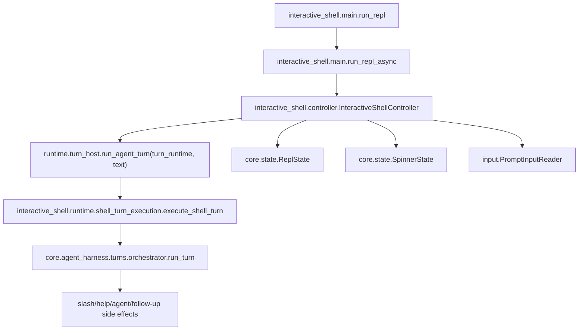

# 运行时包规则

这些说明适用于 `interactive_shell/runtime/` 及其所有子目录。父级 `AGENTS.md` 文件仍然适用。

`runtime` 包存放交互式 shell 运行时的专用支持模块；顶层引导和控制器位于上一级的 `interactive_shell/` 中。

## 归属映射（锁定）

严格保持这些边界。如果变更跨越关注点，应将代码移到归属模块，而不是扩大模块职责。

- `../main.py` — 仅限进程/引导边界：启动清理、TTY/非 TTY 门控、横幅显示、异步边界（`asyncio.run`）。不要将每轮调度/运行时逻辑移回启动引导。
- `startup/initial_input.py` — 仅限脚本化非交互式初始输入重放。
- `../controller.py` — `InteractiveShellController`：提示生命周期、已提交输入处理、排队轮次消费、每轮任务调度、警报监听器设置/拆除（收件箱是运行中 shell 生命周期的一部分）、`AgentTurnResources` 构造与关闭、提示介导的确认等待、轮次遥测、提示/后台/关闭辅助函数之间的协调。其他任何模块都不应拥有 shell 生命周期编排。
- `core/prompt_builder.py` — 仅限 prompt-toolkit 设置、提示渲染回调、待处理提示默认值、自动提交处理。
- `input/` — 仅限提示输入事件转换：EOF、Ctrl-C、CPR 清理、会话恢复提示。
- `input_policy.py` — 仅限轮次的提示 stdin/spinner 门控决策。
- `background/workers.py` — 仅限警报监视器生命周期、spinner 计时器生命周期、采样器启动、轮次启动后台输出排空。
- `core/state.py` — `ReplState`、`SpinnerState`：仅限运行时状态和转换辅助函数（见下方状态归属规则）。
- `core/turn_detection.py` — 仅限用于取消/确认检测的纯文本分类器。
- `core/confirmation.py` — 仅限提示介导的确认等待。
- `turn_host.py` — `run_input_loop`（读取/处理输入直到退出）、`run_agent_turn_queue`（通过注入的 `run_turn` 消费排队提示）、`run_agent_turn(runtime, text)`（呈现、调度状态、提示介导的确认、轮次入口调用），基于 `AgentTurnResources` —— 控制器构造的不可变依赖包（`session`、`state`、`spinner`、`invalidate_prompt`、`request_exit`）。
- `agent_presentation.py` — `ConsoleAgentEventSink`：仅限 agent 生命周期事件的终端呈现（spinner、提示抑制、`console.print`、CPR 排空）—— 不在轮次入口适配器或核心 harness 中。
- `shell_turn_execution.py` — `execute_shell_turn`：绑定 shell 适配器（`action_turn.py`、`answer_turn.py`）以及围绕 `core.agent_harness.turns.orchestrator.run_turn` 的记账。每个适配器拥有自己的绑定；测试从归属模块导入它们，而不是从 `shell_turn_execution` 导入。
- `core.agent_harness.session.tasks` — 仅限通过 `/tasks` 和 `/cancel` 暴露的跨会话任务注册表。
- `core.agent_harness.accounting.token_accounting` — 仅限会话范围的 LLM token 记账和运行元数据。
- 可复用的每 agent 会话状态（`Session`）位于 `core.agent_harness.session`。终端运行时上下文组装（`ReplRuntime`、`create_repl_runtime`）位于 `interactive_shell.runtime.context`。

## 数据流契约（锁定）

交互式运行时必须保持此形态 —— 不要反转此依赖方向：

1. `interactive_shell.main.run_repl`（同步入口点）设置进程级关注点并调用 `run_repl_async`。
2. `interactive_shell.main.run_repl_async`（异步主体）创建 `InteractiveShellController`。
3. `InteractiveShellController.start_interactive_shell` 拥有提示生命周期、已提交输入处理、排队轮次消费和每轮任务调度。
4. `runtime.turn_host.run_agent_turn_queue` 通过注入的 `run_turn` 可调用对象消费排队提示，生产环境中为 `lambda text: run_agent_turn(self.turn_runtime, text)`。
5. `runtime.turn_host.run_agent_turn(runtime, text)` 驱动一个已提交轮次：呈现设置、提示介导的确认、调度状态、每轮执行。
6. `interactive_shell.runtime.shell_turn_execution.execute_shell_turn` 围绕 `core.agent_harness.turns.orchestrator.run_turn` 绑定 shell 适配器。
7. `core.agent_harness` 拥有单个提示的动作/回答机制和记账终结。`AgentEvent` 发射的终端呈现位于 `runtime/agent_presentation.py`。

## 状态归属规则

- `ReplState` 是以下内容的唯一事实来源：活动调度任务、取消事件、确认事件/响应生命周期、退出请求，以及显式轮次 `phase`（`TurnPhase`：`IDLE`、`DISPATCHING`、`AWAITING_CONFIRMATION`、`CANCELLING`）。
- 通过 `ReplState` 转换方法变更轮次状态，绝不要从其他模块直接修改原始字段：
  - `start_dispatch` / `attach_turn_task` / `attach_cancel_event` -> `DISPATCHING`
  - `begin_confirmation` -> `AWAITING_CONFIRMATION`；`clear_confirmation` 返回到 `DISPATCHING`/`IDLE`（且绝不覆盖进行中的 `CANCELLING`）
  - `cancel_current_dispatch` -> `CANCELLING`（仅当有可取消内容时）然后发出取消/确认事件信号并 `task.cancel`
  - `finish_dispatch` / `clear_current_task` -> `IDLE`
- `phase` 是确认和取消的权威来源。`is_dispatch_running()` 仍派生自 asyncio 任务（进行中轮次的运行时真相）；`is_awaiting_confirmation()` 和 `is_cancelling()` 派生自 `phase`。
- 不要重排 `cancel_current_dispatch` 内的信号发送顺序，也不要在 `begin_confirmation` 中将 `confirm_response` 重置移到 `confirm_event` 发布之后；两种顺序对取消和确认的竞态安全都是关键。具体而言：Esc 或裸取消命令必须将轮次移至 `CANCELLING`，并在 `task.cancel` 之前同时发出取消事件和任何待处理确认事件的信号；确认提示是取消安全的，绝不能静默自动确认；确认期间的取消不得降级回 `DISPATCHING`。
- `SpinnerState` 仅拥有 spinner 渲染状态；它不得依赖运行时任务管理。

## 轮次执行规则

- 不要重新引入 `dispatch.py`、`AgentTurnRunner` 风格的包装类，或任何仅用于兼容性的转发模块。
- 轮次记账整合在 `interactive_shell/runtime/core/turn_accounting.py` 中的 `ShellTurnAccounting` 之后，由 `execute_shell_turn` 调用。它拥有动作 agent 分析、终端轮次聚合遥测、提示记录器增强、历史记录，以及最终的助手意图标记。共享的 `run_turn` 拥有每次调度的提示记录器创建和刷新。`runtime.action_turn.run_action_tool_turn` 仅返回事实（`ToolCallingTurnResult`，`accounting_status` 为 `completed` / `not_run`），自身不发出分析。不要将记账重新分散回 `run_action_tool_turn` 或独立的 `_record_*` 辅助函数。

## 兼容性表面策略

- `runtime/__init__.py` 应为薄导出层；不要在其中重复业务逻辑。
- `runtime/__init__.py` 从 `core.agent_harness.session` 导出 `Session`，从 `interactive_shell.runtime.context` 导出运行时上下文辅助函数。新的共享运行时代码应直接从 `core.agent_harness.session` 导入会话名称。
- 不要为兼容性重新添加 `_xxx` 下划线别名或包装函数。测试和调用方应从归属子模块导入规范名称。

## 测试接缝策略

- 优先修补规范模块接缝：`interactive_shell.controller.*` 用于提示循环、排队轮次和确认行为；`interactive_shell.main.*` 用于进程/引导行为；`runtime.core.state.*` 用于状态特定行为。
- 避免添加新的测试来 monkeypatch `runtime.__init__` 中的包根内部实现，除非没有稳定的规范接缝。